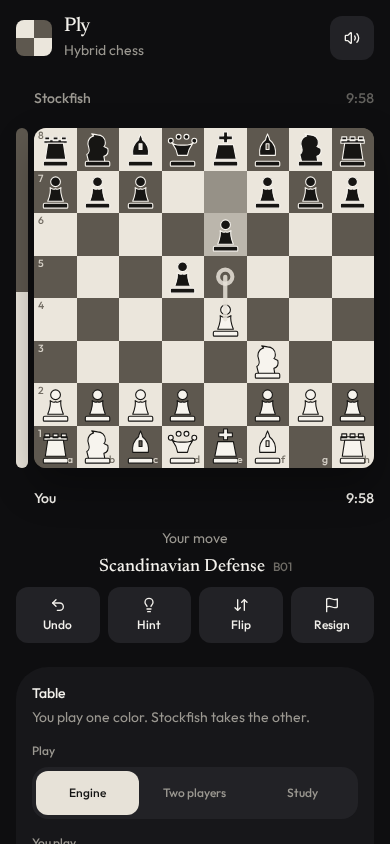

# Ply

Hybrid chess in the browser. One board, three tables: you against Stockfish or the built-in engine, two people on the same screen, or a study board for a line from the opening book.


The rules come from [chess.js](https://github.com/jhlywa/chess.js). Stockfish 19 lite plays in the browser, and a smaller alpha-beta engine is there when you want a faster opponent that follows the opening book. Nothing is sent to a server. The game lives in this browser.

## Tables

| Table | What you can do |
| --- | --- |
| Engine | Take White or Black against Stockfish or the built-in engine. |
| Two players | Pass the screen. The board can turn after each move. |
| Study | Move either color. Hint asks the built-in engine and does not play. |

Clocks are off, or 5, 10, or 15 minutes. Undo, flip, hint, and resign sit under the board. Tap a ply in the move list to jump there, or copy the position as FEN. Stockfish also scores the position: an evaluation bar, a graph, and three best lines. Turn that panel off when you want a serious game. The [engine guide](docs/engine.md#stockfish) explains both.



A hint draws an arrow. The opening name and ECO code appear once the moves match a line in the book.


## Documentation

| Guide | What it covers |
| --- | --- |
| [Playing](docs/playing.md) | Input, clocks, promotion, results, sound, saving |
| [Opening book](docs/openings.md) | How names are chosen, how the engine uses the book, full catalog |
| [Engine](docs/engine.md) | Search, evaluation, strength levels, hints |
| [Architecture](docs/architecture.md) | Modules and how a move moves through the app |
| [Development](docs/development.md) | Install, scripts, and local-only state |

## Run it

```bash
npm install
npm run dev
```

The dev server listens on port 8080. There are no accounts. [Development](docs/development.md) has the other scripts.

## Keys

| Key | Action |
| --- | --- |
| `←` | Undo |
| `F` | Flip the board |
| `H` | Hint |

## Stack

React 19, TanStack Start, Tailwind CSS, Zustand, chess.js. Search runs off the main thread. Pieces are drawn as SVG, not a sprite font.
